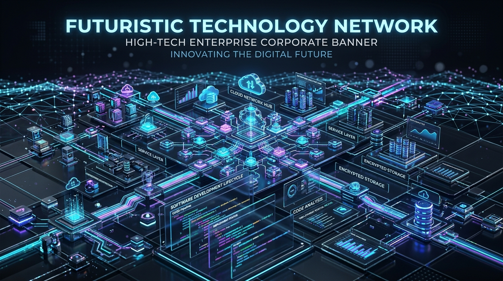

# SiaTech — Enterprise Technology Solutions & Talent Network



**SiaTech** is a premier digital technology partner delivering high-impact IT consulting, elite tech freelancers, corporate workforce training, and bespoke software development to startups and enterprises worldwide.

---

## 🚀 Core Service Pillars

1. **Strategic IT & Cloud Consulting**
   - Enterprise multi-cloud architecture (AWS, GCP, Azure)
   - Generative AI & LLM integration readiness roadmaps
   - Microservices deconstruction, DevOps automation & GitOps
   - Zero-trust security audits, ISO 27001 & SOC-2 compliance

2. **Freelancer Hire & Staff Augmentation**
   - Top 3% globally vetted senior engineers, architects, and designers
   - Guaranteed candidate matching and sprint onboarding within 48 hours
   - 1-Week risk-free trial with zero upfront obligation
   - Flexible dedicated full-time, part-time, or autonomous squad models

3. **Enterprise IT Solutions Training**
   - Live, project-based bootcamps designed by industry practitioners
   - Generative AI & Production RAG Systems Masterclass
   - Enterprise Kubernetes & Cloud Infrastructure
   - Modern Next.js 16, React 19 & Full-Stack Web Architecture
   - Bespoke private corporate cohorts with custom company syllabi

4. **Custom Software Development**
   - End-to-end full-cycle SaaS platform engineering
   - High-throughput web & mobile apps (Next.js, TypeScript, React Native)
   - Real-time event-driven microservices & API ecosystems
   - 100% intellectual property & code ownership transferred to client

---

## 🛠️ Tech Stack & Architecture

- **Framework**: [Next.js 16](https://nextjs.org) (App Router, Turbopack, Partial Prefetching)
- **UI Library**: React 19 & TypeScript
- **Styling**: Vanilla CSS Modules with custom Design System tokens (`globals.css`)
- **Iconography**: Lucide React
- **Typography**: Plus Jakarta Sans & JetBrains Mono

---

## 📁 Project Structure

```
siatech/
├── public/
│   └── images/              # High-resolution architectural & lab visuals
├── src/
│   ├── app/
│   │   ├── about/           # About SiaTech: mission, values, global presence
│   │   ├── contact/         # Consultation booking & SLA inquiry portal
│   │   ├── hire-talent/     # Filterable talent directory & rate calculator
│   │   ├── services/        # Deep dive into all 4 pillars & comparison matrix
│   │   ├── training/        # IT training bootcamps & curriculum download
│   │   ├── globals.css      # Design system variables, dark mode & animations
│   │   ├── layout.tsx       # Root layout with responsive Navbar & Footer
│   │   └── page.tsx         # Interactive Home page
│   └── components/
│       ├── Navbar.tsx       # Glassmorphic header with services mega-menu
│       ├── Footer.tsx       # Enterprise footer with newsletter & credentials
│       ├── HeroSection.tsx  # Dynamic hero banner with live statistics
│       ├── ServicesGrid.tsx # Interactive 4-pillar showcase & tabs
│       ├── TalentCalculator.tsx # Instant rate & team configuration widget
│       ├── TrainingSpotlight.tsx # Curriculum tracks & syllabus request
│       ├── TechStackSection.tsx  # Interactive stack category explorer
│       ├── CaseStudiesSection.tsx# Measurable client outcomes & reviews
│       └── ContactSection.tsx    # Multi-service quote & inquiry form
```

---

## ⚡ Getting Started

### 1. Install Dependencies
```bash
npm install
```

### 2. Run the Development Server
```bash
npm run dev
```

Open [http://localhost:3000](http://localhost:3000) in your browser.

### 3. Production Build
```bash
npm run build
npm run start
```

---

## 📄 License & Ownership
&copy; 2026 SiaTech Solutions Inc. All rights reserved.
